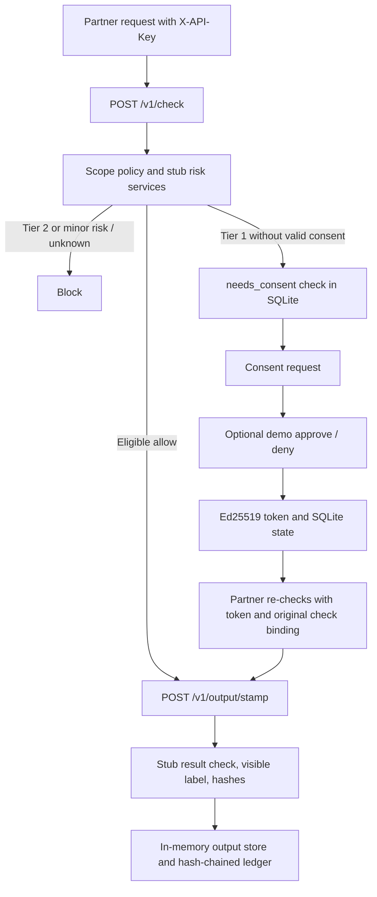

# ConsentGuard Prototype Architecture

This document describes the implemented Issues 1–3 prototype, not the intended
production architecture. Request-risk scoring, face/age assessment, and output
safety checking are stubs. Subject approval in demo mode is a simulated bearer
code, not identity verification. This prototype is not a production safety
system.

## Implemented request and consent flow

The gateway derives app identity from the configured API key and server-side
`CONSENTGUARD_APP_ID`. Consent grants are bound to that app, scope,
target-reference digest, request and originating check. Revocation is checked
against SQLite before authorization. Tier 2 operations are hard-blocked and
cannot be authorized by consent.

## Implemented components and state

- **FastAPI gateway**: `/v1/check`, consent lifecycle routes, output stamping,
  output download, ledger lookup, and ledger verification. Partner routes use
  `X-API-Key`; simulated subject actions use demo action codes.
- **Consent service**: Ed25519-signed short-lived tokens and SQLite-backed
  request, token, and revocation state. SQLite is a single-host prototype
  store, not a multi-host coordination mechanism.
- **Risk adapters**: Request scoring returns an unassessed stub; face/age
  assessment consumes client-supplied test signals only when explicitly
  enabled. Neither is production detection.
- **Result checker**: Explicit test stub; does not perform NSFW, nudity, or
  biometric detection. Errors and indeterminate results fail closed.
- **Provenance**: Visible `AI-generated` label, SHA-256 digests, `dhash-64`,
  canonical hash-chained metadata ledger, exact/near lookup, and chain
  verification. The ledger is in-memory and process-local.
- **Output storage**: Stamped image bytes are in-memory, app-bound, and
  capacity-limited. They disappear on restart or eviction.
- **Audit and enforcement**: In-memory, process-local prototype adapters.
- **TypeScript SDK** (`sdk-ts/`): Check, stamp, download, perceptual-hash
  lookup, and consent verification methods. It does not wrap every consent
  lifecycle route or `/v1/ledger/verify`.

## Security and provenance boundaries

The visible label is not a signed C2PA manifest. Hashes and ledger entries do
not establish authorship, identity, legal admissibility, or trusted time.
No-match lookup does not establish authenticity. The SDK and server do not
provide production key management, KMS/HSM integration, multi-key rotation,
distributed persistence, real subject authentication, or trusted safety
classifiers. Keep demo flags disabled outside isolated local testing.

For request and response fields, auth requirements, errors, and the next
frontend integration boundary, see [docs/ISSUE-4-HANDOFF.md](docs/ISSUE-4-HANDOFF.md).
