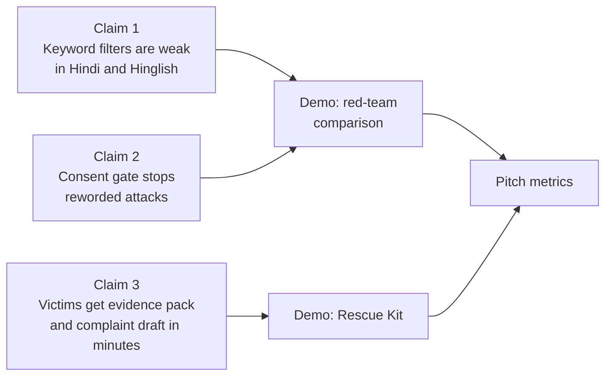
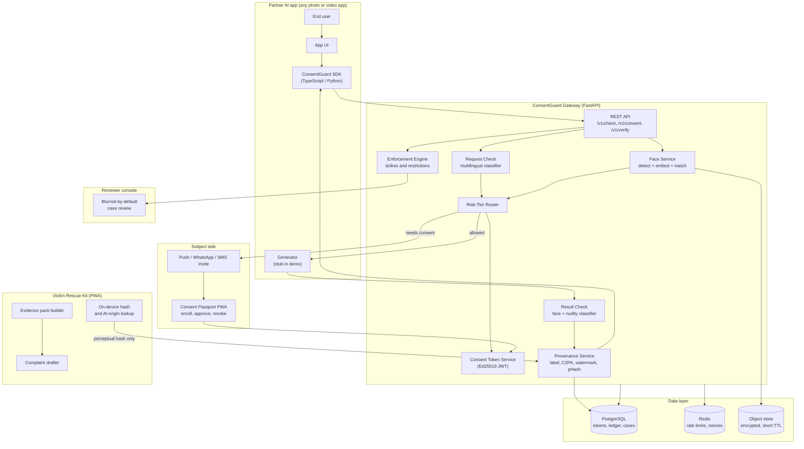
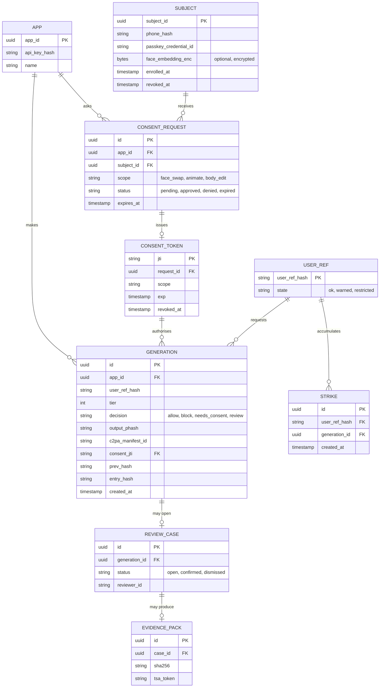
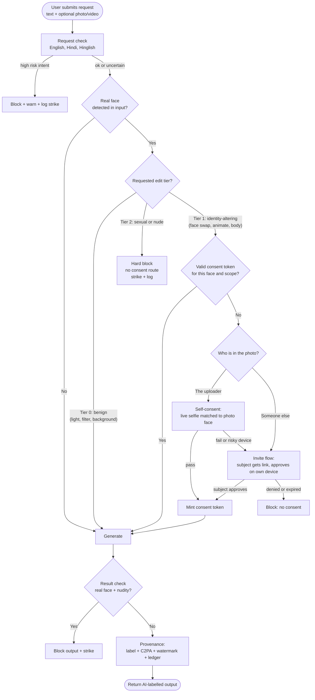
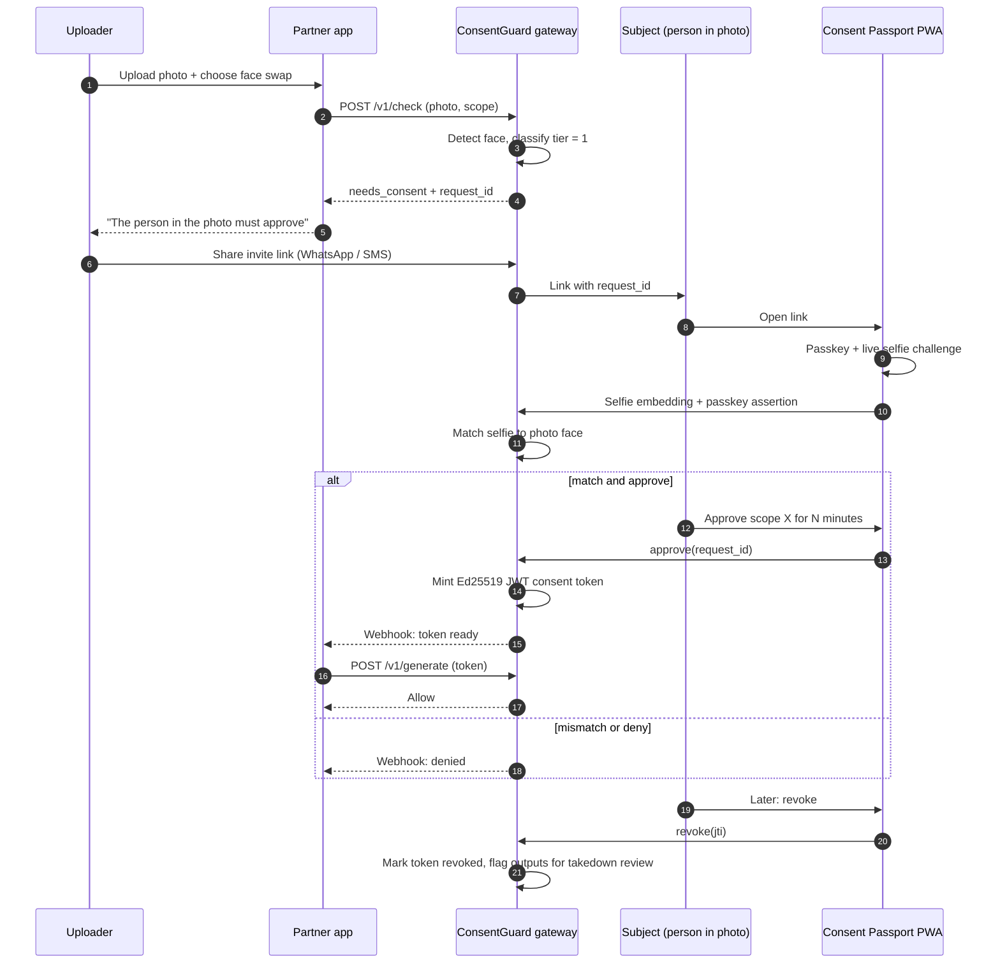
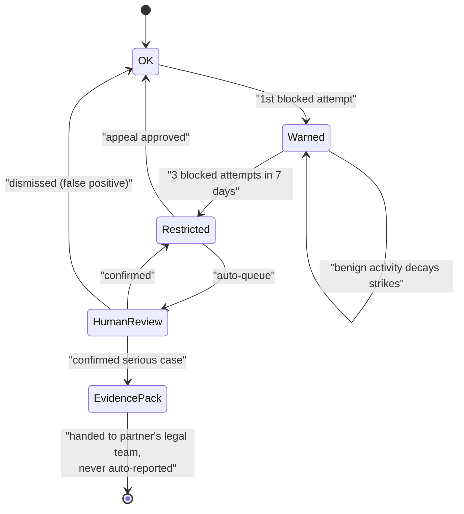
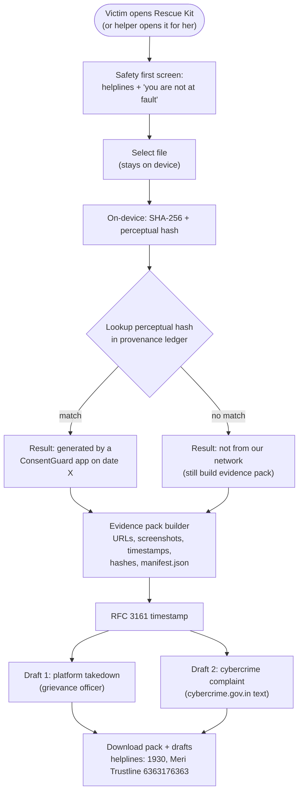
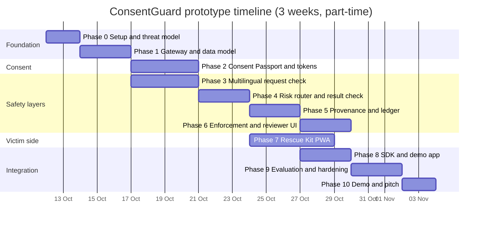
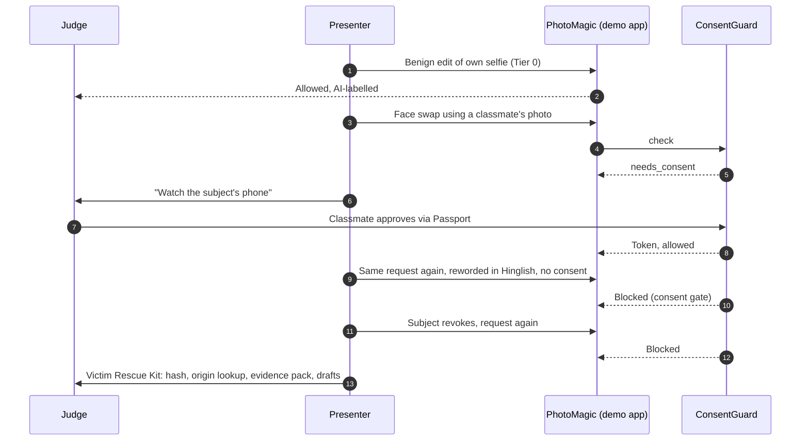

# ConsentGuard: Prototype Implementation Plan

> Consent-first likeness safety for AI photo and video apps, with a victim rescue kit built for Indian infrastructure.
> This plan takes the refined design from idea to a demo-ready prototype in clear phases.

---

## 0. How to read this plan

| Item | Value |
|---|---|
| Goal | A working prototype that **blocks** non-consensual edits of real faces, **proves** provenance of allowed outputs, and **helps** victims file evidence and complaints |
| Team size | 4 members (adjust phase owners) |
| Full build | about 3 weeks part-time |
| Weekend MVP cut | Phases 1, 2, 4, 5 (minimal) and 8, marked **[MVP]** below |
| Safety rule for the build | **Never connect an explicit-capable image model.** The demo generator is a harmless stub (style filter or SFW-locked API). We demonstrate the *gate*, not the abuse. |

---

## 1. Scope: what the prototype proves



**In scope:** consent tokens, risk tiers, multilingual request check, result check, provenance (label, C2PA, watermark, ledger), repeat-attempt enforcement, reviewer console, victim PWA, SDK, mock app.

**Out of scope for the prototype (roadmap):** hardware-grade injection-resistant liveness, cross-platform hash sharing with StopNCII-style partners, production KMS and HSM, formal legal review.

---

## 2. System architecture



### Design principles
1. **Consent belongs to the subject**, not the uploader.
2. **Defence in depth**: text check, consent gate, result check, provenance. No single layer is trusted alone.
3. **Data minimisation**: no raw photos stored by default; short-TTL encrypted buffers; tokens and hashes only.
4. **Humans decide consequences**: the system blocks and flags; people review before any evidence pack is prepared. No auto-reporting.

---

## 3. Tech stack

| Layer | Choice | Why |
|---|---|---|
| Gateway API | **Python 3.11, FastAPI, Pydantic** | ML libraries are Python-native; async; auto OpenAPI docs |
| Database | **PostgreSQL 16** (+ `pgcrypto`) | Ledger, tokens, cases; hash-chain via SQL |
| Cache / nonces | **Redis 7** | Rate limits, challenge nonces, replay protection |
| Object storage | **MinIO** (local) or S3 | Encrypted short-TTL buffers |
| Face detect + embed | **InsightFace (ArcFace, ONNX)** or **MediaPipe Face Detector** | Open source, runs on CPU |
| Liveness (prototype) | **MediaPipe Face Landmarker** challenge-response (random head turn, random digits) | Cheap and demonstrable; documented as injection-vulnerable |
| Mobile hardening (roadmap) | **Android Play Integrity API**, **iOS App Attest** | Device attestation against virtual-camera injection |
| Request check | **IndicXlit** (transliteration) + **MuRIL / IndicBERT** fine-tune + LLM fallback (Claude Haiku via API) | Handles Hindi, Hinglish, Kannada code-mixing |
| Image NSFW classifier | Open ViT NSFW classifier from Hugging Face, or **NudeNet** | Used only as a *defensive* output check |
| Consent tokens | **Ed25519-signed JWT** (`PyJWT` + `cryptography`) | Short-lived, scoped, revocable |
| Subject auth | **WebAuthn passkeys** + phone OTP (Twilio or MSG91 sandbox) | Binds the subject to their own device |
| Provenance | **c2pa-python** (C2PA manifests), **invisible-watermark** (DWT-DCT), **PDQ / pHash** (`pdqhash`, `imagehash`) | Layered, because no single mark is robust |
| Ledger | Hash-chained rows in Postgres (optional: anchor root hash on a public chain later) | Tamper-evident |
| Evidence packs | **WeasyPrint** (PDF), `zipfile`, SHA-256, **RFC 3161 timestamp** (public TSA) | Reproducible, timestamped |
| Victim PWA | **React + Vite + TypeScript + Tailwind**, **ONNX Runtime Web**, WASM hashing | On-device, offline-capable |
| Reviewer console | React + shadcn/ui, RBAC | Blur-by-default for reviewer wellbeing |
| SDK | **TypeScript (npm)** and **Python (pip)** thin clients | A few lines to integrate |
| Infra | **Docker Compose**, GitHub Actions, deploy on Render / Fly.io / a small VM | Student-friendly |
| Observability | Prometheus + Grafana, structured logs with **no PII** | Evaluation metrics and audit |
| Testing | `pytest`, Playwright, Locust (load), custom red-team harness | Evidence for the pitch |

---

## 4. Repository layout

```text
consentguard/
├── gateway/                 # FastAPI service
│   ├── app/
│   │   ├── api/             # routes: check, consent, verify, victim
│   │   ├── core/            # config, security, keys, logging
│   │   ├── services/
│   │   │   ├── request_check.py
│   │   │   ├── face.py
│   │   │   ├── router.py        # risk-tier router
│   │   │   ├── consent.py       # token issue/verify/revoke
│   │   │   ├── result_check.py
│   │   │   ├── provenance.py    # C2PA, watermark, pHash, ledger
│   │   │   └── enforcement.py
│   │   ├── models/          # SQLAlchemy models
│   │   └── schemas/         # Pydantic
│   ├── migrations/          # Alembic
│   └── tests/
├── sdk-ts/                  # npm package: @consentguard/sdk
├── sdk-py/                  # pip package
├── passport-pwa/            # Consent Passport (subject side)
├── rescue-pwa/              # Victim Rescue Kit
├── reviewer-console/        # human review UI
├── demo-app/                # "PhotoMagic" mock partner app + stub generator
├── eval/                    # red-team harness, datasets (private), reports
├── docs/                    # threat model, DPDP checklist, API spec
└── docker-compose.yml
```

---

## 5. Data model



---

## 6. Core flows

### 6.1 Generation request (the gate)



### 6.2 Consent via invite (sequence)



### 6.3 Repeat-attempt enforcement



### 6.4 Victim Rescue Kit



> The file itself is never uploaded. Only a perceptual hash leaves the device, and only if the user taps "check origin".

---

## 7. API contract (v1)

| Method | Path | Purpose | Key fields |
|---|---|---|---|
| POST | `/v1/check` | Gate decision for a request | `prompt`, `lang_hint`, `image_ref`, `scope`, `user_ref` |
| POST | `/v1/consent/requests` | Create invite for a subject | `check_id`, `channel` |
| POST | `/v1/consent/approve` | Subject approves (passkey + selfie) | `request_id`, `assertion`, `selfie_embedding` |
| POST | `/v1/consent/revoke` | Subject revokes | `jti` |
| POST | `/v1/generate/verify` | Partner submits token before generating | `jti`, `check_id` |
| POST | `/v1/output/stamp` | Result check + provenance stamp | `image`, `check_id` |
| GET | `/v1/ledger/lookup?phash=` | Victim-side origin lookup | `phash` |
| POST | `/v1/cases` | Reviewer actions | `generation_id`, `decision` |
| POST | `/v1/evidence/pack` | Build evidence pack | `items[]` |

Example response from `/v1/check`:

```json
{
  "check_id": "c_9f2a",
  "decision": "needs_consent",
  "tier": 1,
  "reasons": ["real_face_detected", "scope:face_swap"],
  "consent_options": ["self_selfie", "invite_subject"],
  "request_risk": {"score": 0.31, "lang": "hinglish"}
}
```

---

## 8. Implementation phases

Each phase lists **steps**, **deliverables**, and a **definition of done**. Phases marked **[MVP]** form the weekend cut.



### Phase 0: Setup and threat model (Day 1 to 2)

**Steps**
1. Create the monorepo and `docker-compose.yml` (Postgres, Redis, MinIO, gateway).
2. Write `docs/threat-model.md`: attackers (opportunistic user, persistent abuser, injection attacker), assets (subject faces, tokens), controls.
3. Define the **tier policy** as data (`policy.yaml`) so it is auditable and editable without code:

```yaml
tiers:
  0: {name: benign, examples: [lighting, background, filter, crop]}
  1: {name: identity_altering, examples: [face_swap, animate_photo, body_edit, voice_clone], needs: consent_token}
  2: {name: sexual_or_nude_of_real_face, action: hard_block, applies_to: [any_real_face]}
minors: {action: hard_block_tier1_and_2}
retention: {raw_buffers_minutes: 15, tokens_days: 30, ledger: hash_only}
```
4. Set up CI (lint, `pytest`), pre-commit, secrets via `.env`.

**Done when:** `docker compose up` brings the stack up and `GET /health` returns 200.

### Phase 1 [MVP]: Gateway and data model (Day 3 to 5)

**Steps**
1. Scaffold FastAPI with routers from section 7; add Alembic migrations for the section 5 schema.
2. Implement **API-key auth** for partner apps (store only `sha256(api_key)`).
3. Add structured logging with PII scrubbing (no prompts or images in logs).
4. Add Redis-backed **rate limiting** per `user_ref_hash` (HMAC of the app's user ID with a per-app salt, so we never see real IDs).

**Done when:** `/v1/check` returns a stubbed decision and every call writes a ledger row.

### Phase 2 [MVP]: Consent Passport and tokens (Day 6 to 9)

**Steps**
1. **Face service** (`face.py`): detect faces, compute ArcFace embeddings, return `face_count`, `bbox`, `embedding`. Reject if more than one face unless the scope covers all (start with single-face only).
2. **Consent Passport PWA**: enrol (phone OTP, passkey, optional encrypted embedding), approve or deny, revoke.
3. **Live selfie challenge**: random head-turn plus random digits via MediaPipe; server issues a nonce stored in Redis (60 s TTL) to stop replays.
4. **Match**: cosine similarity between selfie embedding and the face in the photo; thresholds in config (start at ~0.45 for ArcFace cosine and tune on your own test set). Never accept a match from a low-quality or tiny face.
5. **Token service**: mint a scoped, time-limited token.

```python
# gateway/app/services/consent.py
import time, uuid, jwt  # PyJWT
from cryptography.hazmat.primitives.asymmetric.ed25519 import Ed25519PrivateKey

def mint_token(priv: Ed25519PrivateKey, *, subject_id, face_fp, scope, app_id, ttl=900):
    now = int(time.time())
    claims = {
        "jti": str(uuid.uuid4()),
        "sub": str(subject_id),
        "face_fp": face_fp,          # hash of embedding, not the embedding
        "scope": scope,              # e.g. "face_swap"
        "aud": str(app_id),
        "iat": now, "exp": now + ttl,
    }
    return jwt.encode(claims, priv, algorithm="EdDSA")

def verify_token(pub, token, *, app_id, scope, face_fp, is_revoked):
    c = jwt.decode(token, pub, algorithms=["EdDSA"], audience=str(app_id))
    assert c["scope"] == scope and c["face_fp"] == face_fp
    assert not is_revoked(c["jti"])
    return c
```
6. **Revocation**: `revoked_at` on the token; partner apps check `/v1/generate/verify` at generation time, and revocation flags past outputs for takedown review.

**Done when:** an invite link → approval on a second device → token → `verify` succeeds; revoke → `verify` fails.

### Phase 3: Multilingual request check (Day 6 to 9, parallel)

> This layer is a **first warning only**. Its job is to add friction and logging, not to be the defence.

**Steps**
1. **Normalise**: lower-case, strip zero-width characters, Unicode NFKC, transliterate Latin-script Hindi (Hinglish) to Devanagari with IndicXlit so one model sees both forms.
2. **Build a small labelled dataset**: label *intent to alter a real person's body or identity* vs. benign edits. Use templated, **non-explicit** phrasing plus paraphrases in English, Hindi, Hinglish (and Kannada if you want a local edge). Keep it private and do not publish attack prompts.
3. **Fine-tune** MuRIL or IndicBERT as a binary or 3-class classifier (benign, identity-altering, sexualising). Calibrate scores.
4. **LLM fallback** for uncertain scores (0.35 to 0.65): a short zero-shot prompt to a small hosted model, with a strict JSON schema. Cache results.
5. Output only `{score, lang, label}`; never block on this layer alone for Tier 0 edits of non-face images.

**Done when:** on your held-out set, report precision and recall per language and a *bypass rate* for reworded variants (this is the baseline in your pitch).

### Phase 4 [MVP]: Risk-tier router and result check (Day 10 to 12)

**Steps**
1. Implement the router from flow 6.1 as a pure function so it is easy to test:

```python
# gateway/app/services/router.py
def decide(req_risk, faces, tier, token_ok, minors_flag):
    if tier == 2 and faces:              return "block_hard"
    if minors_flag and tier >= 1:        return "block_hard"
    if req_risk >= 0.8:                  return "block_warn"
    if not faces or tier == 0:           return "allow"
    if tier == 1 and token_ok:           return "allow"
    return "needs_consent"
```
2. **Tier classifier**: map the requested operation (from the SDK's structured `scope` field, not free text) to a tier. Free text only adds risk score. Structured scopes are what make this robust to rewording.
3. **Minor flag**: use a conservative age estimator as a *signal*; when unsure and the face looks young, route to hard block for Tier 1 and 2.
4. **Result check** (`result_check.py`): after generation, run face detection plus an NSFW classifier on the output. Block if **real face and nudity** (or if face-match to the input face is high and nudity is flagged).
5. Add unit tests for every branch of `decide()`.

**Done when:** a table-driven test of 40+ cases (all tiers × token states × languages) passes.

### Phase 5 [MVP]: Provenance and ledger (Day 13 to 15)

**Steps**
1. **Visible label**: overlay "AI-generated" text on images; add a lower-third on video.
2. **C2PA manifest**: sign with a prototype certificate using `c2pa-python`; include `generator=app_id`, `check_id`, `consent_jti`.
3. **Invisible watermark**: embed a short payload (check_id prefix) with `invisible-watermark`.
4. **Perceptual fingerprint**: compute PDQ (and pHash fallback) of the output; for video, hash sampled frames.
5. **Hash-chained ledger**:

```python
import hashlib, json
def append_entry(prev_hash: str, entry: dict) -> str:
    payload = json.dumps(entry, sort_keys=True, separators=(",", ":")).encode()
    return hashlib.sha256(prev_hash.encode() + payload).hexdigest()
```
6. Provide `/v1/ledger/lookup?phash=` using Hamming distance ≤ a tuned threshold.
7. **Robustness test**: crop, resize, re-compress, screenshot the output, then measure how often C2PA, watermark and pHash survive. Report honestly. The ledger lookup is the layer that survives when marks are stripped.

**Done when:** a screenshot of an allowed output is still found by `lookup`, even with metadata stripped.

### Phase 6: Enforcement and reviewer console (Day 16 to 18)

**Steps**
1. **Strike engine** per flow 6.3 (state machine); thresholds in `policy.yaml`.
2. **Reviewer console**: queue of cases; images **blurred by default**, click-to-reveal, reviewer actions logged; no bulk export.
3. **Evidence pack for confirmed cases only**: manifest, hashes, timestamps, ledger entries, reviewer decision. Delivered to the *partner app's* legal contact; the system never auto-reports anyone.
4. Add appeal flow (user can contest a restriction).

**Done when:** three blocked attempts in the demo move an account to `Restricted`, appear in the queue, and a reviewer can confirm or dismiss.

### Phase 7: Victim Rescue Kit PWA (Day 13 to 18, parallel)

**Steps**
1. **Safety-first UI**: calm copy, offline-capable, quick-exit button, English and Hindi (add Kannada via a translation file).
2. **On-device hashing**: SHA-256 (`crypto.subtle`) + perceptual hash in a Web Worker; show a clear "this file never leaves your phone" notice.
3. **Optional origin check**: sends only the perceptual hash to `/v1/ledger/lookup`.
4. **Evidence pack builder**: user adds URLs, platform names, dates, screenshots; the app creates `manifest.json` (file hashes, timestamps, device info the user consents to), a PDF summary, and a ZIP. Request an **RFC 3161 timestamp** over the manifest hash.
5. **Complaint drafter**: templates for (a) platform grievance officer takedown and (b) cybercrime portal complaint text; user reviews and edits; clear note that this is a draft, **not legal advice**. Include helplines: 1930 (national cyber helpline), Meri Trustline 6363176363, and the National Cyber Crime Reporting Portal.
6. **Helper mode**: a counsellor or grassroots worker can run the kit *with* the victim on one device (PIN-protected session, nothing saved after).
7. Have a lawyer or legal-aid volunteer review the evidence pack format for admissibility of electronic evidence (certificate requirements under India's evidence law).

**Done when:** from upload to downloadable pack and two drafts in under five minutes, offline except for the optional lookup.

### Phase 8 [MVP]: SDK and demo app (Day 19 to 21)

**Steps**
1. **TypeScript SDK**: three functions.

```ts
import { ConsentGuard } from "@consentguard/sdk";
const cg = new ConsentGuard({ apiKey: process.env.CG_KEY! });

const check = await cg.check({ prompt, image, scope: "face_swap", userRef });
if (check.decision === "needs_consent") {
  // show invite UI: await cg.requestConsent(check.id, { channel: "whatsapp" })
}
if (check.decision === "allow") {
  const raw = await generate(prompt, image);        // partner's own model
  const stamped = await cg.stamp(raw, check.id);    // result check + provenance
  return stamped;
}
```
2. **Python SDK** mirroring the same calls.
3. **Demo app "PhotoMagic"**: a simple React app with a harmless stub generator (e.g., applies a style filter or returns a cartoon-style result). Screens: upload, choose edit type, request, consent flow, result with AI label.
4. **Integration guide** in `docs/` showing the five-line integration.

**Done when:** a fresh developer can integrate the SDK into a toy app in under 15 minutes.

### Phase 9: Evaluation and hardening (Day 22 to 24)

**Steps**
1. **Red-team harness** (`eval/`): a private, **non-explicit** prompt set in English, Hindi, Hinglish with reworded variants. Compare three configurations:
   - **A**: keyword filter only (baseline)
   - **B**: request check only
   - **C**: full ConsentGuard (consent gate + result check)
2. **Metrics**: bypass rate (non-consented Tier 1 edits that were allowed), false-block rate on benign edits (family photos, group photos, selfies), latency p50/p95, consent completion time.
3. **Threat tests**: replayed selfie, printed photo, lookalike face, token reuse across faces, expired and revoked tokens, parameter tampering.
4. **Injection-attack note**: document that the prototype's web liveness does not stop virtual-camera injection; show the roadmap mitigations (device attestation, session binding, subject-side approval).
5. **Privacy check** against a DPDP-style checklist: purpose limitation, notice, retention, deletion on revoke, no raw images in logs.
6. **Load test** with Locust (target: 20 requests per second on a small VM).

**Done when:** you have a one-slide results table (A vs B vs C) and a list of known limits.

### Phase 10: Demo and pitch (Day 25 to 26)

**Demo script (about 4 minutes)**



---

## 9. Testing matrix

| Area | Test | Pass criterion |
|---|---|---|
| Router | 40+ table-driven cases | 100% expected decisions |
| Consent | token reuse on another face | rejected |
| Consent | replayed selfie nonce | rejected |
| Consent | revoke then verify | rejected within 5 s |
| Request check | reworded + Hinglish variants | bypass rate reported vs. baseline |
| Result check | benign portraits, family photos | false-block rate reported |
| Provenance | crop, resize, JPEG, screenshot | `lookup` hit rate reported |
| Victim kit | offline use, 3G network | pack built without network |
| Privacy | log and storage scan | no raw images or prompts persisted |
| Performance | Locust, 20 rps | p95 under target |

---

## 10. Privacy, ethics and legal checklist

- [ ] No raw photos persisted beyond the short-TTL buffer (default 15 minutes).
- [ ] Face embeddings stored only for subjects who **opt in**, encrypted, deleted on revoke. Non-enrolled faces are matched in memory and then discarded, with only a one-way fingerprint kept in the token.
- [ ] Clear consent notice in the Passport (what is stored, why, for how long).
- [ ] No auto-reporting; humans review before any evidence pack.
- [ ] Reviewer wellbeing: blur-by-default, rotation, no bulk download.
- [ ] Minors: hard block for Tier 1 and 2 with no consent route; route any child-related abuse to specialised child-protection channels (for example Meri Trustline).
- [ ] Complaint drafts are labelled "draft, not legal advice".
- [ ] Align with the DPDP Rules timeline (core obligations enforceable from 13 May 2027) and the IT Rules 2026 labelling and takedown duties.
- [ ] Publish the threat model and known limits openly.

---

## 11. Known limits (say these before judges ask)

| Limit | Mitigation in prototype | Roadmap |
|---|---|---|
| Camera-injection can fool selfie liveness | Nonce, random challenge, subject-side approval on own device | Device attestation, injection detection, multi-signal risk scoring |
| Watermarks and metadata can be stripped | Layered marks + ledger lookup by perceptual hash | Standardised hash-sharing with platforms |
| Partners who do not adopt are out of reach | Compliance demand from IT Rules 2026 | Work with app stores, ad networks and payment processors as chokepoints |
| Lookalikes can cause false matches | Conservative thresholds, quality checks, high-risk scopes need approval from the enrolled subject | Hardware-backed identity, consent-manager integration |
| Hindi, Hinglish coverage gaps | Dedicated dataset and evaluation | More Indian languages, community red-teaming |

---

## 12. Future scope

1. **Consent-manager integration:** plug the Consent Passport into India's DPDP consent-manager ecosystem.
2. **Cross-platform hash sharing** with platforms and helplines (StopNCII-style) using perceptual hashes of confirmed cases.
3. **Voice and video:** extend tokens to voice cloning and video swap; add temporal consistency checks.
4. **Grassroots deployment:** helper mode kits for women's helplines, Anganwadi and panchayat digital kiosks.
5. **Regulator dashboard:** anonymised aggregate statistics for compliance reporting.
6. **Proactive photo protection:** optional adversarial "immunisation" of profile photos once methods become fast and robust.

---

## 13. Quick-start commands

```bash
git clone <your-repo> consentguard && cd consentguard
cp .env.example .env                  # set CG_SIGNING_KEY, DB, REDIS
docker compose up -d                  # postgres, redis, minio, gateway
docker compose exec gateway alembic upgrade head
docker compose exec gateway pytest -q
cd passport-pwa && npm i && npm run dev     # subject side
cd ../demo-app   && npm i && npm run dev    # partner demo
```

---

## 14. Key references used to shape this plan

- India IT Rules amendment on synthetically generated information (notified 10 Feb 2026, in force 20 Feb 2026).
- MeitY notice to X over Grok misuse (2 Jan 2026).
- Rati Foundation and Tattle report on AI deepfakes and Indian women (Nov 2025); Parliamentary Committee report on cyber safety of women (Aug 2026).
- MacPrompt (AAAI 2026); Villa et al., USENIX Security 2025; U3-Attack (ACM MM 2025); MPDA (2025).
- StopNCII.org documentation; OpenAI "Creating with Sora safely".
- WEF Cybercrime Atlas (Jan 2026) on face-swap and camera-injection tools.
- C2PA specification; watermark-removal studies (NeurIPS 2024 challenge and related work).
- DPDP Rules 2025 timeline; Take It Down Act (US) platform duties effective May 2026.
